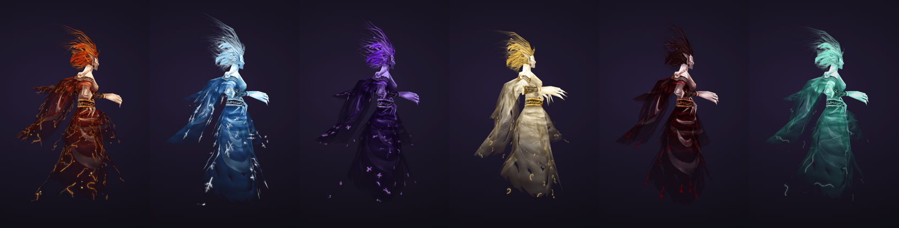
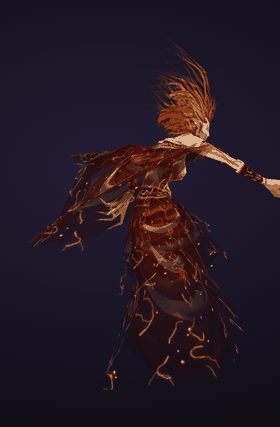
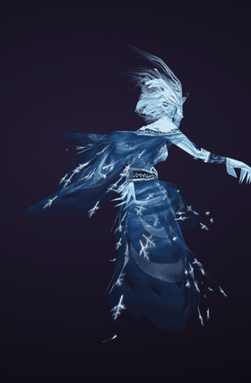
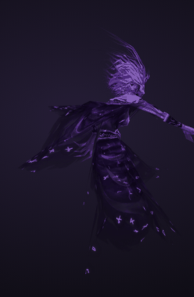
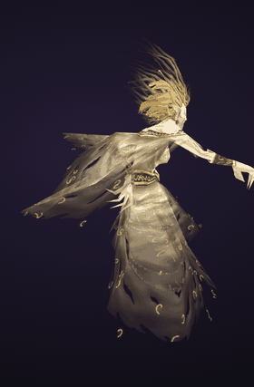
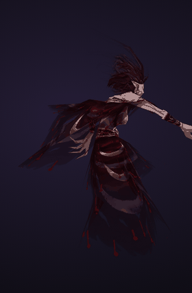
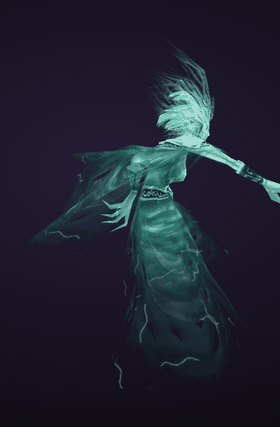
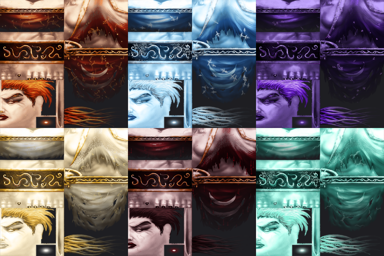

# Banshee Variants

Six recoloured skins for the WotLK 3.3.5a banshee model (`Creature\Banshee\Banshee.m2`, the Nissa Agamand / Undercity banshee). Every variant uses the stock model, so all of its animations work.

| Ember | Frost | Void | Radiant | Blood | Spectral |
|---|---|---|---|---|---|
|  |  |  |  |  |  |

Each variant has hand-painted detail on top of the recolour: ember cracks and sparks, rime crystals, void runes, gold filigree, blood drips, spectral wisps.

| Variant | Skin file | Display (1.0x / 1.5x) | Test NPC |
|---|---|---|---|
| Ember Wraith | BansheeSkinEmber | 97701 / 97707 | 958701 |
| Frost Wailer | BansheeSkinFrost | 97702 / 97708 | 958702 |
| Void Keener | BansheeSkinVoid | 97703 / 97709 | 958703 |
| Radiant Lament | BansheeSkinRadiant | 97704 / 97710 | 958704 |
| Blood Widow | BansheeSkinBlood | 97705 / 97711 | 958705 |
| Spectral Mourner | BansheeSkinSpectral (alpha 170) | 97706 / 97712 | 958706 |

## Install (3.3.5a / AzerothCore)

1. **Client:** build the skins yourself from your own client: extract `Creature\Banshee\BansheeSkin.blp` to PNG, run `python tools/recolor.py BansheeSkin.png`, `python tools/paint.py`, then `python tools/blp.py Ember Frost Void Radiant Blood Spectral`, and pack the BLPs into a patch MPQ as `Creature\Banshee\BansheeSkin<Name>.blp`. (This repo ships no Blizzard game files.)
2. **Client DBC:** add 12 rows to `DBFilesClient\CreatureDisplayInfo.dbc`. Copy row 915 and change: ID, scale, alpha, and TextureVariation_1 = `BansheeSkin<Name>`. Pack it into your highest-priority patch.
3. **Server:** run `sql/banshee_apply.sql` on your world DB, then restart the worldserver. This adds the `creaturedisplayinfo_dbc`, `creature_model_info`, `creature_template` and `creature_template_model` rows. Undo with `sql/banshee_revert.sql`.
4. **In game:** `.morph 97701` or `.npc add 958701`.

## How they were made

`tools/recolor.py` splits the original texture into parts (skin, robe, hair, gold trim, lips, dark belt) using soft hue/saturation masks. Each part goes through its own colour ramp from shadow to highlight, so the original hand-painted shading and brushwork survive. `tools/blp.py` writes BLP2 DXT5 files with full mipmaps (same format as the stock skin, needs `pip install pillow numpy quicktex`). 

## Credits

Base model and textures © Blizzard Entertainment. Fan-made recolours for private and educational use, with no affiliation to Blizzard.
